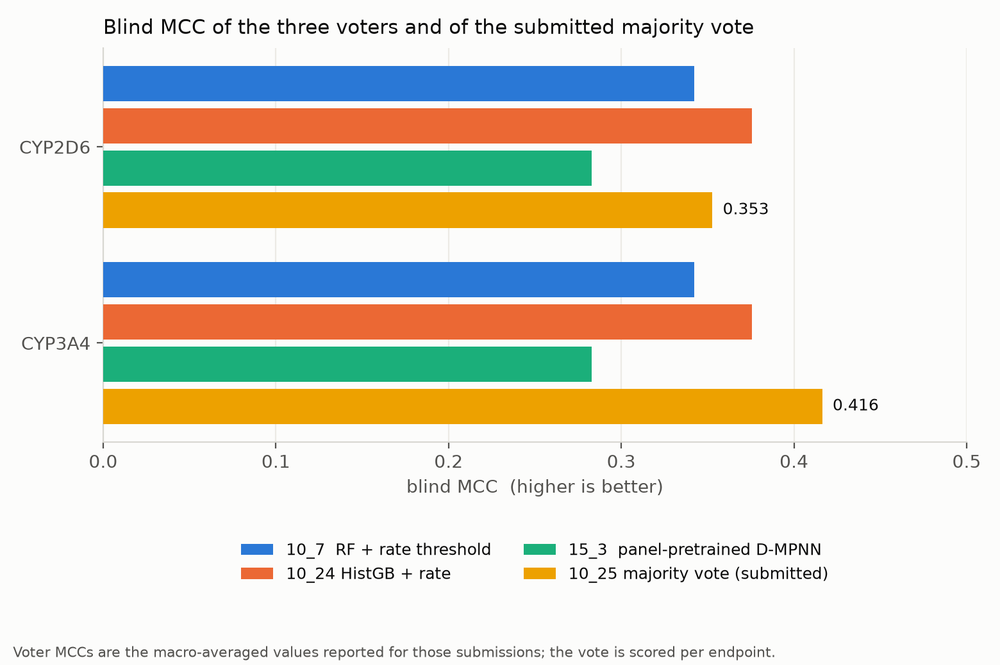

# Time-dependent inhibition — binary classification

**Submission:** `10_25_majority_vote_classification_submission.csv`
**Blind score:** macro-averaged MCC **0.3846** (CYP2D6 **0.3528**, CYP3A4 **0.4164**)
**Author:** Jamal Shamsara

---

## 1. Task and data

Two binary endpoints were predicted for each of the 750 blinded compounds:
`CYP2D6_is_TDI` and `CYP3A4_is_TDI` — whether a compound is a time-dependent inhibitor of
that enzyme.

Only the challenge release was used for labels. Both endpoints are **strongly imbalanced**,
and the two differ from each other by a factor of three in base rate:

| Endpoint | Labelled compounds | Positives | Positive rate |
|---|---|---|---|
| `CYP2D6_is_TDI` | 1,497 | 324 | 21.6% |
| `CYP3A4_is_TDI` | 3,584 | 764 | 21.3% |

The released `CYP1A2_is_TDI` and `CYP2C9_is_TDI` columns (23 and 38 positives respectively)
are too sparse to model and were not part of the scored task.

Supporting information used as features or auxiliary supervision, never as labels:

- **Emax versus positive control** and the TDI-condition pIC50 columns from the same release,
  including their confidence bounds;
- the **Veith et al. (2009) PubChem qHTS CYP panel** (AID 1851, 16,486 compounds), used to
  pre-train a graph encoder;
- **reactivity and bioactivation SMARTS alerts** — deduplicated RDKit `FilterCatalog` sets
  plus a curated nine-class CYP mechanism-based-inactivation panel encoded from the
  literature, validated against 32 of 32 known MBI positive controls.

## 2. The metric, and the calibration problem it creates

The primary metric is **Matthews correlation coefficient**, macro-averaged over the two
endpoints. MCC is sensitive to the *number* of positives a classifier calls, not only to how
it ranks them. On an imbalanced problem this makes the decision threshold, rather than the
model, the dominant free parameter.

This turned out to be the single most important finding for this track. The blind set's
positive rate differs from the training set's, and a classifier thresholded at its
training-optimal operating point calls far too many positives on the blind compounds.

The response was **rate-matched thresholding**: for each endpoint the threshold is chosen so
that the *fraction of blinded compounds called positive* matches an externally estimated
target prevalence, rather than to maximise any local score.

| Endpoint | Target called rate | Achieved on the blind set |
|---|---|---|
| `CYP2D6_is_TDI` | 0.067 | 0.0467 |
| `CYP3A4_is_TDI` | 0.292 | 0.2773 |

Both targets are well below the 21% training prevalence. Selection was therefore made on
**AUC** — which is threshold-free — with the operating point set separately and afterwards.
Selecting on MCC directly would have confounded the model with its threshold.

## 3. The three voters

Three classifiers were submitted independently, scored on the blind set, and then combined.
They were chosen to be **comparable in strength and different in kind**; their individual
blind MCCs span a narrow band (0.283–0.376) while their underlying representations and
inductive biases do not overlap.

### 3.1 `10_7` — random forest on selected descriptors

Random forest over RDKit descriptors and fingerprints with recursive feature elimination
(150 features for CYP2D6, 50 for CYP3A4) and `class_weight="balanced_subsample"`. Thresholds
0.358 and 0.304 respectively, set by rate matching.

Blind MCC **0.3421**.

### 3.2 `10_24` — histogram gradient boosting, unselected features

`HistGradientBoostingClassifier` over the full unselected 1,011-column TDI feature matrix,
averaged over three seeds. Deliberately the opposite choice to `10_7` on feature selection:
boosting on all features against a forest on few. Local honest AUC 0.799 (CYP3A4) and 0.536
(CYP2D6).

Blind MCC **0.3757** — the strongest single model.

### 3.3 `15_3` — panel-pre-trained graph neural network

A Chemprop **D-MPNN** encoder pre-trained on the 16,486-compound PubChem CYP panel, then
fine-tuned multitask on `is_TDI`, averaged over seeds 13/17/23. This is the only voter that
sees no hand-built descriptors at all, and the only one with external pre-training.

Its local AUC was slightly *worse* than the random forest on CYP3A4 (0.791 vs 0.813) and
slightly better on CYP2D6 (0.605 vs 0.591). It was submitted anyway, because the aim was
diversity rather than individual strength.

Blind MCC **0.2829** — the weakest voter, and still useful (§4).

## 4. The submitted model: 2-of-3 majority vote

The submission is a **boolean majority vote**: a compound is called a time-dependent
inhibitor for an endpoint if at least **two of the three** classifiers call it positive. The
vote is taken on the hard calls, after each member's own rate-matched threshold, not on
averaged probabilities — so each member contributes its calibrated decision, not its raw
score.

| | CYP2D6 | CYP3A4 | Macro |
|---|---|---|---|
| `10_7` RF | — | — | 0.3421 |
| `10_24` HistGB | — | — | 0.3757 |
| `15_3` D-MPNN | — | — | 0.2829 |
| **`10_25` majority vote** | **0.3528** | **0.4164** | **0.3846** |

The vote beats its best member by **0.009 macro MCC**, and on CYP3A4 by **0.041** — gained
chiefly from the member that was individually weakest. Its called rates (0.047 and 0.277)
remain close to the targets, which matters: a vote can drift away from a calibrated operating
point, and here it drifts slightly conservative rather than permissive.

Reported alongside the primary metric, the vote achieves accuracy 0.929 / precision 0.497 /
recall 0.307 / F1 0.374 on CYP2D6 and accuracy 0.762 / precision 0.597 / recall 0.569 /
F1 0.581 on CYP3A4. The CYP2D6 recall is low by construction — rate matching to a 6.7% target
on a 21.6%-prevalence training set trades recall for precision deliberately.

## 5. Mechanistic features: what they did and did not contribute

A substantial reactivity-alert effort fed this track and is worth reporting for its negative
results as much as its positive one.

- A **59-SMARTS mechanism-based-inactivation panel** was assembled from the literature across
  nine mechanistic classes and validated on known MBI positive controls (32 of 32 recovered).
- The strongest single association found was **methylenedioxyphenyl → `CYP2D6_is_TDI`**, an
  enrichment of **2.64×** (p = 3.8 × 10⁻⁴). This is a textbook MBI motif — it forms a
  metabolic-intermediate complex with the heme iron — and recovering it from the challenge
  labels alone was a useful check that the labels behave as the chemistry predicts.
- A hypothesis that tertiary amines would drive `CYP3A4_is_TDI` was **falsified** on this
  data.
- **Ionization state** at pH 7.4, added as derived feature columns, improved the descriptor
  random forest on CYP2D6 (+0.045) but was **worse** at the graph-model frontier — a useful
  reminder that a feature's value is model-relative.
- A TabPFN null experiment established that `CYP2D6_is_TDI` is **feature-limited rather than
  model-limited**: changing the estimator family did not move it, which is consistent with
  its weak local AUC (0.54–0.61) across every method tried.

## 6. Local validation

The same protocol as the regression track was used: in-fold feature selection and
hyperparameter choice, scaffold splitting, inactives retained, with per-endpoint thresholds
below which a local difference was not treated as evidence. Selection was on AUC; MCC was
only computed after the operating point had been fixed.

An overfitting guard rejected any configuration with `(train − CV) / train > 0.20`.

## 7. Reproducibility notes

- Random seed 13; multi-seed averaging at 13/17/23 where stated.
- Feature sets and fitted preprocessors were frozen before modelling and reused unchanged.
- Each voter's provenance — model, feature variant, target rate, achieved rate and threshold —
  is recorded per endpoint, and the blind score written back once known.
