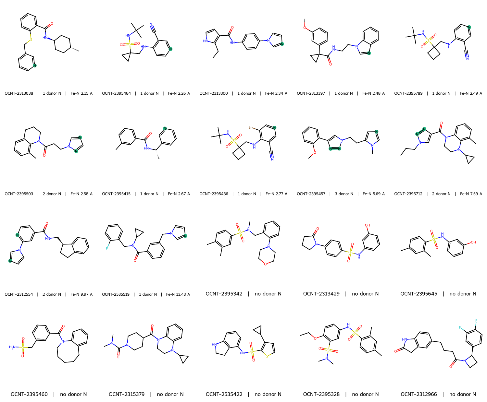
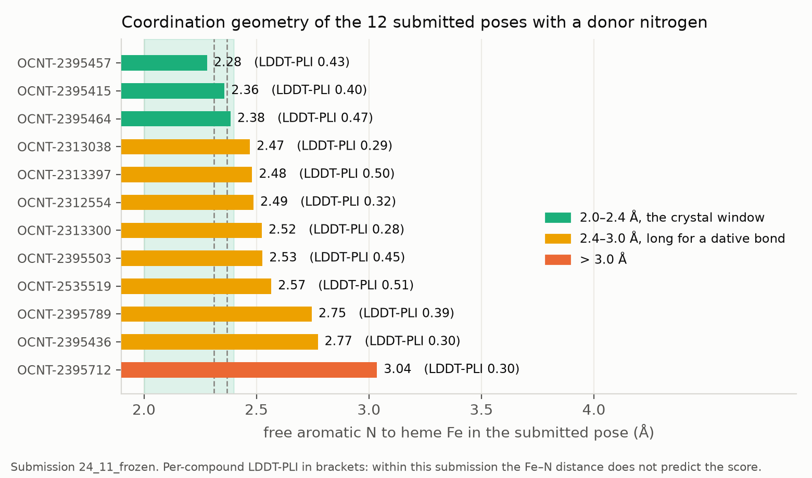

# CYP3A4 structure prediction — protein–ligand pose

**Submission:** `24_9_manual_structures.zip`
**Author:** Jamal Shamsara

---

## 1. Task

Predict the 3D structure of the CYP3A4 complex for 20 compounds **from SMILES alone**, scored
by **LDDT-PLI** against blinded Cryo-EM structures, with BiSyRMSD, LDDT-LP and Coverage
reported alongside.

Two hard gates apply: a complex that fails the organisers' structure validator incurs
LDDT-PLI 0 plus a 20 Å penalty, and a complex that fails **PoseBusters** scores LDDT-PLI 0.
Both are checked locally before every submission, and both are treated as part of the method
rather than as a formality — an earlier internal build lost a structure to a PoseBusters
failure that a visual check had passed.

## 2. The 20 ligands

*Donor nitrogens — neutral aromatic N carrying no hydrogen, i.e. with a lone pair available to
ligate iron — are highlighted. Fe–N is the distance in the submitted pose.*

The set divides cleanly on a single chemical criterion that determines which binding mode is
even available:

| Group | n | Composition |
|---|---|---|
| **Free aromatic N** (type-II capable) | **12** | pyridines, imidazoles, a benzimidazole, 1,2,3- and 1,2,4-triazoles |
| **No donor nitrogen** | **8** | sulfonamides, amides, a morpholine, a 2-oxindole |

Compound size is tightly distributed: 18–27 heavy atoms, median 24.

Three of the twelve (`OCNT-2395436`, `OCNT-2395464`, `OCNT-2395789`) share an
aminopyridine-nitrile core and required special handling (§4.1). None of the 20 carries a
designed covalent warhead; several are mechanism-based inactivators, which is a different
property and does not imply a covalent pose.

## 3. Receptor preparation

**Ten holo CYP3A4 X-ray entries** were used as docking targets: `3UA1`, `4D6Z`, `6BCZ`,
`6BDH`, `6DA5`, `6DAA`, `6MA6`, `6MA7`, `6OOB`, `7UFB`. They were selected from a survey of
all CYP3A4 PDB entries by filtering on holo + heme present + X-ray + resolution ≤ 2.5 Å +
ligand heavy-atom range, then sorting by resolution and deduplicating by ligand code.

Design units, including heme as a cofactor, were built with **OpenEye Spruce**. Where an entry
contains several crystallographically independent copies, only the copy nearest the ligand is
retained — the entries share residue numbering across copies, so keying on residue number
alone silently merges them.

**Two limitations of this panel were quantified after the fact and are reported here because
they bound what the method could achieve.**

First, the panel is far less diverse than selection on resolution implies. Across the 94
pocket residues present in all ten receptors, pairwise side-chain RMSD is median **0.71 Å**
(range 0.29–1.14), and average-linkage clustering returns **a single cluster even at a 2.0 Å
cut**. Only Phe-304 and Arg-217 move appreciably (≈2.0 Å). Two of the ten (`6DA5`, `6DAA`)
have crystal ligands with **identical SMILES**, and five of the ten are the same
ritonavir-analogue chemotype.

Second, `4D6Z` is a defective target. It was co-crystallised with **both** its drug-like
ligand and **imidazole**, and the imidazole occupies the axial heme site
(Kaur *et al.*, *J. Med. Chem.* 2016, **59**, 4210–4220). Our pipeline selected the drug-like
ligand as the reference, so Spruce stripped the imidazole — leaving an empty axial site in a
protein shaped around an occupant — and centred the docking box 7.33 Å off the iron. `4D6Z`
has the best resolution of all ten (1.93 Å), which is precisely why resolution-based selection
promoted it. It contributes no pose to this submission.

## 4. Ligand preparation

Ligands were prepared from SMILES only; no external 3D geometry entered any pose.

- **Protonation:** OpenEye QUACPAC at pH 7.4, followed by `OEGetReasonableProtomer` for the
  dominant tautomer.
- **Stereochemistry:** unspecified centres enumerated with `OEFlipper`. Two ligands arrive with
  stereochemistry the organisers resolved from the Cryo-EM; those were used as given and never
  re-enumerated.
- **Conformers:** Omega dense sampling.

### 4.1 A protonation correction

`OEGetReasonableProtomer` assigned **+1** to the three aminopyridine-nitriles, protonating the
pyridine ring nitrogen and thereby **removing their only possible iron ligand**. An
independent microspecies calculation showed the **neutral** form is the dominant species at
pH 7.4 for all three, with the next species appearing only above pH 8 — consistent with the
expected pKa, since the amino group's basicity is largely cancelled by the ring nitrile
(pyridine 5.2, 4-aminopyridine 9.1, 3-cyanopyridine 1.45).

All three were re-prepared from the challenge SMILES as given and re-docked. With the correct
species, two of the three reach the 2.0–2.4 Å crystal window (2.26 and 2.25 Å) where as
cations they had no coordinating nitrogen at all. The correction is the reason the type-II
group in §2 numbers 12 and not 9.

## 5. Pose generation

Two independent engines were used on every ligand × receptor pair.

**OpenEye POSIT** (`OEPositMethod_ALL`), a template-guided cascade that tries SHAPEFIT and MCS
overlay, then template-biased HYBRID docking, then template-free FRED, reporting which engine
fired. Ten poses were requested per pair. **On these ligands the cascade falls through**:
SHAPEFIT and MCS fired zero times across the pool and FRED supplied roughly two-thirds of the
poses. The reason is measurable — the highest Tanimoto similarity between any challenge ligand
and any of the ten crystal ligands is **0.497**, and the largest common substructure is a
median of **8 heavy atoms** against ligands of 18–27. The panel offers these compounds
essentially two usable templates, not ten.

**AutoDock Vina 1.2.7** with Meeko, ligands embedded by RDKit ETKDG from SMILES, box
enveloping each receptor's own crystal ligand, `exhaustiveness=24`, 30 poses retained per
pair. Heme is appended as rigid atoms with element-level AutoDock types, since Meeko cannot
template it.

**Vina cannot produce a type-II pose, and this is a property of its scoring function rather
than of the search.** Its closest approach of a free aromatic nitrogen to the iron is **2.79 Å**
over 1,797 poses, and **2.87 Å** over an independent 1,800-pose run — the same wall twice, with
zero poses inside 2.6 Å. Vina has no metal-coordination term, so the iron is treated as an
ordinary atom and its van der Waals repulsion stops a nitrogen at contact distance; a real
dative Fe–N bond at 2.0–2.3 Å lies inside that wall. POSIT's Chemgauss4 does include a metal
term and reaches **2.01 Å**. Vina was therefore used for pose *diversity*, and POSIT for the
coordinating compounds.

## 6. Pose selection

Selection, not generation, is the bottleneck: across the pool the best available pose is far
better than the pose any score selects.

Two selectors were tested head-to-head on the blind set by submitting them as a controlled
A/B over the same pose pool, changing one variable:

| Rule | LDDT-PLI | BiSyRMSD | Coverage |
|---|---|---|---|
| Fe–N coordination for type-II compounds | **0.3939** | 3.945 Å | 1.0 |
| POSIT probability alone | 0.2894 | 5.595 Å | 1.0 |

**Coordination geometry is worth +0.105 LDDT-PLI** — the largest effect measured anywhere in
this work, and the only pose-selection signal validated on blind data. The probability-only
arm placed half of its type-II nitrogens 4–17 Å from the iron, outside the heme site
entirely. `posit_probability` barely discriminates on this set: 62 of 200 candidates share the
value 0.24 and only 3 of 20 compounds have a unique argmax, so "highest probability" resolves
to whatever breaks the tie.

A local control built from cross-docking the ten crystal ligands **failed to predict this**,
calling the two rules indistinguishable (paired Wilcoxon p = 0.58). The reason is now clear:
on crystal ligands POSIT's SHAPEFIT template overlay fires about half the time, while on the
challenge ligands it never fires. The control was measuring a different algorithm, so its
p-values cannot accept or reject a rule for the blind set.

The same cross-docking data does support one weaker, independently validated claim. Receptors
are not interchangeable: median cross-docking RMSD spans 4.70 Å to 6.61 Å. No single best
receptor can be named — bootstrap confidence intervals are ≈2 Å wide — but under
leave-one-ligand-out a better **half** validates, at −0.49 Å (p = 0.037, better on 8 of 10
ligands), with `7UFB`, `6BDH` and `6DAA` in the good group in 9–10 of 10 folds and `4D6Z`,
`6MA7`, `3UA1`, `6OOB` never in it.

### 6.1 The submitted selection

For the final submission, all 2,346 poses in the three good receptors were inspected
**visually**, one PyMOL session per receptor, with every pose of every compound presented as a
state and the measured Fe–N geometry available alongside. The final pose for each compound was
chosen by eye against the criteria in §7, not by a score.

| | |
|---|---|
| Receptors used | `7UFB` ×16, `6DAA` ×4 |
| Engines | POSIT ×19, Vina ×1 |
| Compounds with a donor N | 12 |
| …in the 2.0–2.4 Å crystal window | 3 |
| …within 2.6 Å | 6 |

Four compounds with an available donor nitrogen were deliberately placed non-coordinating
(5.7–13.4 Å). For two of them (`OCNT-2312554`, `OCNT-2395712`) no pose in the pool reaches the
crystal window at all — their best is 3.00 Å and 2.74 Å, and the 1,2,3-triazole of the latter
is the weakest donor class present (triazolium pKa ≈ 1.2 against ≈5.2 for pyridinium). For the
other two, coordinating poses exist in the pool but were judged, on inspection, to be
geometrically poor in other respects. This is a departure from the rule validated in §6 and is
reported as such.

One substitution was made after the manual selection: `OCNT-2313300` state 9 in `7UFB` failed
PoseBusters' `minimum_distance_to_organic_cofactors` — the ligand pressed into the porphyrin —
and was replaced by state 5 of the same receptor (Fe–N 2.34 Å), chosen from the
PoseBusters-clean alternatives.

Each chosen pose was recombined with **its own** receptor's protein and heme, never with a
common reference frame, because a pose generated in one receptor and written into another is
scored against side chains it was never docked against.

## 7. What a correct pose looks like, measured

Nine deposited CYP3A4 complexes were used to calibrate the acceptance criteria, with the
geometry measured rather than assumed. The modes separate on two quantities:

| | coordinating (6 entries) | non-coordinating (3) |
|---|---|---|
| Fe–N | **1.94–2.42 Å** | 5.02–6.09 Å, or no donor |
| iron out of the donor ring plane | **0.15–0.88 Å** | 2.41–5.23 Å |
| donor ring tilt from edge-on | **1–14°** | 52–59° |
| closest ligand C above the porphyrin | **2.56–3.03 Å** | **3.46–3.97 Å** |
| ligand atoms within 4 Å of the porphyrin core | **14–27%** | 2–9% |

References include ketoconazole (`2V0M`, 2.10 Å), clotrimazole (`8SPD`, 1.94 Å) and bare
imidazole (`4D6Z`, 2.42 Å, 1.93 Å data — iron 0.36 Å off the ring plane, Fe–N–C 125/125°).

Two of these numbers did real work. **The last row discriminates on its own**: a coordinating
ligand is pulled down onto the heme by its ≈2 Å bond, so a pose showing a short Fe–N while its
carbons sit 3.5 Å above the porphyrin is internally inconsistent. And **contacting the
phenylalanine cluster proves nothing about the mode** — coordinating ligands touch 2–6 of
Phe-213/215/304, Ala-305, Thr-309, Ile-369 and non-coordinating ligands 5–6 — because a
type-II ligand still has to fill the cavity once its nitrogen is bound.

Accordingly, non-coordinating compounds were judged on **occupancy of the P1 and P2
hydrophobic subpockets** flanking the Phe cluster and the heme, at 3.3–3.8 Å, and *not* on
stacking flat against the porphyrin, which no deposited structure in this panel does.

## 8. Validation of the submitted file

| Check | Result |
|---|---|
| Organisers' structure validator | **valid**, no errors |
| PoseBusters (22 checks per complex) | **20 / 20 fully clean** |
| Structures present | 20, none missing or unexpected |
| Protein sequence | **0 mismatches** against UniProt P08684 over the resolved range |

The complexes carry 462 resolved residues (`7UFB`, 16 files) or 450 (`6DAA`, 4 files), numbered
27–497 — the standard N-terminally truncated CYP3A4 construct — and every resolved residue
matches UniProt P08684.

Fe–N contacts at 2.15–2.77 Å pass `minimum_distance_to_inorganic_cofactors` — PoseBusters does
not treat genuine coordination as a clash.

One packaging detail is worth recording for other entrants: the validator reads the ligand
back and matches it to the expected SMILES with RDKit's
`AssignBondOrdersFromTemplate`, and with explicit ligand hydrogens present that match failed on
8 of our 20 ligands even though the heavy-atom graph was provably correct in every case
(verified by formula, heavy–heavy bond count and per-element degree signature). Stripping the
ligand hydrogens resolves it. We could not establish the mechanism; the effect is
reproducible.

## 9. Known limitations

- The receptor panel is effectively three distinct structures, not ten (§3), which caps what
  multi-receptor docking can contribute.
- POSIT's template machinery never engaged on these ligands (§5), so most poses come from
  template-free search — the component of POSIT with the least advantage over any other docking
  program.
- No deposited CYP3A4 complex contains a nitrile ligand, so nitrile coordination has no
  template and no yardstick. A constructed ideal nitrile pose is sterically feasible in the
  roomier receptors, but no docked pose approaches it; in any case all three nitrile-bearing
  compounds also carry a pyridine nitrogen, which is the better donor, so the question is moot
  for this set.
- Four compounds depart from the blind-validated coordination rule (§6.1).
