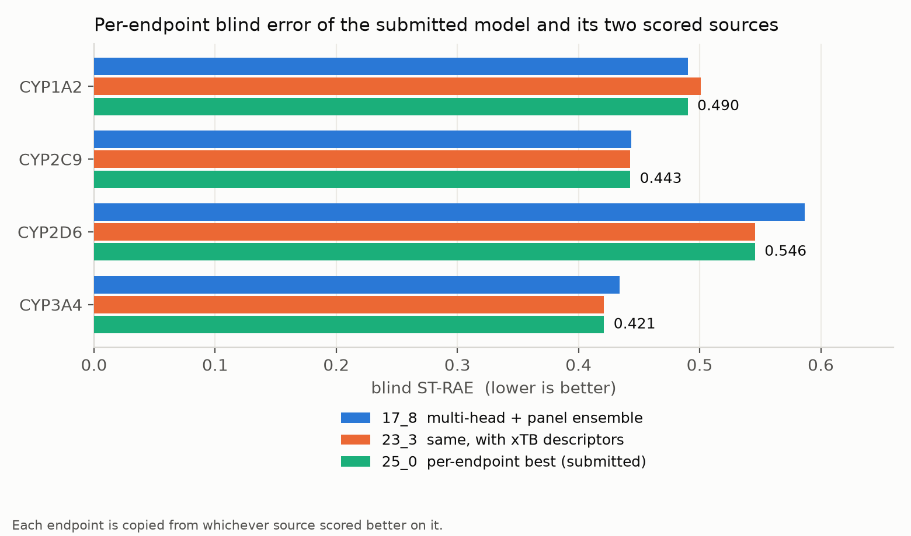

# Direct CYP inhibition — pIC50 regression

**Submission:** `25_0_per_endpoint_best_regression_submission.csv`
**Blind score:** macro-averaged ST-RAE **0.4749** across the four endpoints; the same
predictions rescored on the full 750-compound reveal gave **0.4593**.
**Author:** Jamal Shamsara

---

## 1. Task and data

Four endpoints were predicted for each of the 750 blinded compounds:
`CYP1A2`, `CYP2C9`, `CYP2D6` and `CYP3A4` `pIC50_direct_inhibition`.

Training data came from the challenge release only. The four endpoints are unevenly
measured, and that imbalance shaped every modelling decision:

| Endpoint | Training compounds with a direct-inhibition pIC50 |
|---|---|
| CYP1A2 | 1,412 |
| CYP2C9 | 1,285 |
| CYP2D6 | 1,493 |
| CYP3A4 | 2,335 |

Two further released tables were used as **auxiliary supervision**, never as targets:
`cyp-challenge-TRAIN_TDI.csv` (pIC50 measured under the TDI pre-incubation condition, 1,285–3,583
compounds per enzyme) and `cyp-challenge-TRAIN_Emax.csv` (Emax versus positive control, with
per-measurement confidence bounds). Both describe the same enzymes under a different assay
condition, so they are informative about the shared chemistry while being systematically
offset from the target.

One external dataset was used: the **Veith et al. (2009) PubChem qHTS CYP panel**
(AID 1851), 16,486 compounds assayed against five CYP isoforms. It entered in two distinct
roles — as a feature block (predictions of a panel-trained model, used as descriptors) and as
pre-training supervision for a graph encoder. It was the first external source in this work
to move blind performance rather than only local performance.

## 2. Metric and what it forces

The primary metric is **ST-RAE** — a soft-thresholded relative absolute error — macro-averaged
over the four endpoints. Two consequences drove the design:

1. **It is an error, not a correlation.** A model can rank compounds well and still score
   badly if its predictions are offset or over-dispersed relative to the blind labels. Early
   submissions here showed exactly that: good Spearman, poor ST-RAE.
2. **ST-RAE and R² want different calibrations.** Shrinking predictions toward the mean
   improves ST-RAE and damages R². The submitted model is calibrated for ST-RAE, explicitly.

Because the metric is macro-averaged, the four endpoints are independent problems with equal
weight — which is what makes the final assembly step (§5) legitimate rather than a trick.

## 3. Local validation protocol

A dedicated methodology study established which local protocol predicts blind placement at
all. Candidate protocols were scored by the rank correlation between their local ranking of
already-scored submissions and those submissions' actual blind scores. One combination
reached pooled Spearman **+0.62** and agreed with the blind ordering on 4 of 4 endpoints:

- **feature selection and hyperparameter choice inside each CV fold**, never once on the full
  training set;
- a **scaffold split** rather than a random split;
- **inactives retained** in both train and test rather than filtered out.

All three matter. Selecting features on the full set before splitting inflated local scores by
more than the differences being measured. Per-endpoint thresholds were derived below which a
local difference is not evidence; differences smaller than those thresholds were not acted on,
which is why several locally attractive variants were never submitted.

An overfitting guard was applied throughout: a configuration was rejected if
`(train − CV) / train > 0.20`, and the best non-overfitting configuration was preferred over
the best raw configuration.

## 4. The two model families behind the submission

The submitted predictions come from two scored submissions, each itself an ensemble. The
design principle for combining them was **strong and diverse**: members of comparable
individual strength but low mutual rank correlation. Earlier attempts that mixed a strong
member with weak ones, or that combined identically-seeded replicates, did not improve on
their best member.

### 4.1 `17_1` — multi-head graph encoder on a union frame

A single Chemprop **D-MPNN** encoder with one head per task, trained on the union of all
released measurements rather than on each endpoint separately. The four direct-inhibition
endpoints are the scored heads; the TDI-condition pIC50 columns and the Emax columns enter as
auxiliary heads with loss weight **0.3**. This lets the encoder learn from compounds that were
never measured on the scored endpoint, without requiring any cross-assay calibration — the
offsets are absorbed by the separate heads.

### 4.2 `15_2` — descriptor MLP with panel features and censored calibration

RDKit descriptors plus ECFP, extended with a block of **PubChem panel** features, fed to a
multilayer perceptron. The panel's qHTS readouts are **censored** — many compounds are only
known to be inactive above the highest tested concentration — and that censoring was handled
explicitly as interval bounds rather than imputed to a point value.

### 4.3 `17_8` — rank-average of the two

Per endpoint, the two members' predictions are converted to ranks, averaged, and mapped back
through the **pooled quantiles** of the two members' predicted distributions. Rank-averaging
removes each member's calibration before combining; the pooled-quantile mapping then restores
a single, deliberately chosen calibration. Member rank correlation ranged from 0.62 (CYP2D6)
to 0.87 (CYP3A4) — the diversity the method requires.

Blind: MA-ST-RAE **0.4885**.

### 4.4 `23_3` — the same ensemble with xTB electronic descriptors

GFN2-xTB single-point calculations over the full compound deck supplied electronic
descriptors (global and local: ω, Fukui f⁺ on reactive atoms). These were added to the
multi-head member only, **quantile-transformed** because several of the quantities have poles
that make raw values unusable as model input.

Critically, xTB was **not applied to every endpoint**. A frontier study measured the change
in local rank correlation per endpoint and applied the block only where it was positive:
CYP1A2 (Δρ +0.016) and CYP3A4 (Δρ +0.013). CYP2C9 (+0.005) and CYP2D6 (−0.030) kept the
previous predictions verbatim. The quantile mapping was deliberately **not** re-pooled, so the
arm differs from `17_8` in exactly one respect.

Blind: MA-ST-RAE **0.4776**.

## 5. The submitted model: per-endpoint recombination

Because the metric is a plain macro-average of four independently scored endpoints, and
because both source submissions had already been scored, the final submission takes **each
endpoint's column from whichever source scored better on that endpoint** and copies it
verbatim. No model was retrained and no new prediction was generated.

| Endpoint | `17_8` | `23_3` | Source taken | Submitted ST-RAE |
|---|---|---|---|---|
| CYP1A2 | **0.4901** | 0.5010 | `17_8` | **0.4901** |
| CYP2C9 | 0.4435 | **0.4427** | `23_3` | **0.4427** |
| CYP2D6 | 0.5868 | **0.5457** | `23_3` | **0.5457** |
| CYP3A4 | 0.4337 | **0.4210** | `23_3` | **0.4210** |
| **Macro average** | 0.4885 | 0.4776 | | **0.4749** |

All values are the organisers' per-endpoint blind ST-RAE.

This is an arithmetic step, not a modelling one, and we report it as such. Its expected gain
over the better single source was **0.0027**, which is inside the **0.0166** bootstrap standard
deviation of the macro average — so no change in placement was expected, and none was
observed. It was taken because it cannot lose: every column already carried its own blind
score.

## 6. What did not work, briefly

Recording the negative results is part of the method, since they constrain what the positive
results can mean.

- **Boltz-2 affinity as a feature.** Predicted binding affinities behaved as a clogP proxy and
  did not move any of the four endpoints at the model frontier. A gain seen with a
  random forest was an artefact of a model that was not competitive to begin with.
- **Scaffold-split local wins did not transfer.** A data-centric round that improved local
  scaffold-split performance regressed CYP1A2 and CYP2C9 on the blind set and left CYP2D6
  unchanged.
- **CYP2D6 resisted everything.** For most of this work every CYP2D6 submission scored worse
  than predicting a constant, because the blind label distribution is shifted relative to
  training. The endpoint only moved once censored negatives from the external panel were
  added as supervision on the scored heads — the single largest endpoint-level gain obtained.
- **Ranking, not calibration, is the residual deficit.** A matched-peer analysis against
  better-placed submissions showed the remaining gap is in compound ordering — most sharply
  for CYP2C9 — and ordering is not fixable by any affine recalibration.

## 7. Reproducibility notes

- Random seed 13 throughout; 80/20 hold-out and 5-fold cross-validation.
- Feature-set definitions and fitted preprocessors were frozen before any model was trained
  and reused unchanged, so that submissions remain comparable to one another.
- Every submission is logged with its algorithm, hyperparameters, descriptor set and internal
  metrics, and the blind score was written back against the same row once known.
